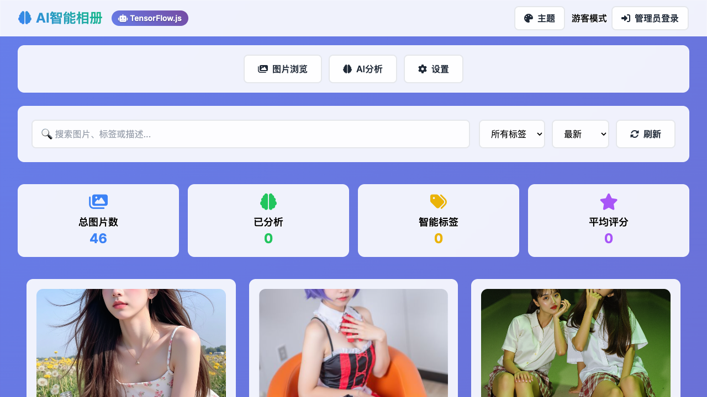

# AI 智能相册（ai-images-galley）

一个以 **TensorFlow.js + GitHub 仓库存储** 为核心的智能相册项目，包含经典单页应用、模块化重构版和 FastAPI 实验后端。

> **先看状态**：`index.html` 是功能完整的稳定入口；`index-modular.html` 已支持浏览、搜索、上传和分页视图；`backend/` 的图像管理是真实文件系统实现，AI/Prompt/多模态支持 OpenAI-compatible 模型（无 Key 时自动 mock）。



## 能力状态

| 能力           | `index.html`（稳定）             | `index-modular.html`（预览）   | `backend/`（实验）      |
| -------------- | -------------------------------- | ------------------------------ | ----------------------- |
| 图片浏览       | ✅ GitHub API + 本地清单         | ✅ GitHub API + 清单降级       | ✅ 文件系统 + 静态访问  |
| 上传           | ✅ 提交到 GitHub 仓库            | ✅ GitHub Contents API         | ✅ multipart 上传       |
| AI 分类/检测   | ✅ 浏览器端 MobileNet + COCO-SSD | ✅ 后端 AI 标签页（需配置）    | ✅ 真实模型 / mock 回退 |
| 搜索/排序/分页 | ✅ 基础搜索/排序                 | ✅ 搜索/排序/分页/视图切换     | —                       |
| 管理员         | ✅ GitHub Token + 仓库写权限校验 | ✅ 登录表单已接线              | ⚠️ 可选 `ADMIN_TOKEN`   |
| PWA/离线       | ✅ manifest + Service Worker     | ✅ 同一套 PWA 资源             | —                       |
| Prompt/多模态  | —                                | ✅ Prompt 优化 UI（本地/后端） | ✅ 条件真实 / mock      |
| 测试           | ✅ Playwright E2E                | ✅ Playwright E2E              | ✅ 11 个 API/AI 测试    |

## 快速开始

### 只运行前端（推荐）

```bash
npm run serve
# 等价于 node scripts/static-server.mjs
```

打开：

- 经典版：<http://localhost:8080/index.html>
- 模块化预览版：<http://localhost:8080/index-modular.html>

PWA 安装和 Service Worker 需要 `localhost` 或 HTTPS。

### 运行后端（可选）

```bash
cd backend
# 后端依赖当前固定在 Python 3.11/3.12（Docker 使用 3.11）；3.14 暂无可用的 pydantic-core wheel
python3 -m venv .venv
source .venv/bin/activate
pip install -r requirements.txt
cp .env.example .env
# 编辑 .env：至少设置 SECRET_KEY；可选 ADMIN_TOKEN
# 需要真实 AI 时设置 OPENAI_API_KEY 与 AI_PROVIDER=auto（默认）
python -m app.main
```

后端默认运行在 <http://localhost:8000>，接口文档在 `/docs`。

前端默认**不会**请求后端。需要联调时，在浏览器控制台执行：

```js
localStorage.setItem('api_base_url', 'http://localhost:8000/api/v1');
location.reload();
```

## 架构

```text
经典版 index.html
  图片列表 ── GitHub Contents API ── images/（46 张）
  AI 分析 ── TensorFlow.js（MobileNet / COCO-SSD）── 仅在浏览器
  上传 ── GitHub Contents API（PAT，sessionStorage）
  离线 ── service-worker.js + manifest.json

模块化 index-modular.html
  src/js/config.js / imageSource.js / galleryManager.js / galleryRenderer.js
  数据源 ── GitHub API → images/manifest.json → 目录索引
  上传 ── GitHub Contents API（管理员 Token，浏览器端压缩为 JPEG）
  无后端时纯本地运行；配置 api_base_url 后启用 apiClient

backend/（FastAPI）
  /api/v1/images/*  ── uploads/ 文件系统（真实）
  /api/v1/analysis、prompts、multimodal
    ├─ 配置 OPENAI_API_KEY → OpenAI-compatible 真实模型
    └─ 无 Key / 调用失败 → mock 回退（provider 字段区分）
```

### 数据存储

- 图片：GitHub 仓库 `images/` 目录；`images/manifest.json` 作为离线/限流降级清单。
- 缩略图：`images/thumbnails/*.webp`（640px 宽），由 `scripts/generate-thumbnails.py` 生成。
- 用户备注/自定义标签/设置：浏览器 localStorage（按设备隔离）。
- 后端上传：`backend/uploads/`（原图、缩略图、`.metadata` sidecar）。
- GitHub Token：只在当前标签页 `sessionStorage` 中保存，关闭标签页即失效。

## 常用命令

```bash
npm run serve              # 本地静态服务器（8080）
npm run test:e2e           # Playwright E2E（本地使用系统 Chrome）
npm run build              # 打包 src/js/app.js 到 dist/bundle.js
npm run lint               # ESLint
npm run format:check       # Prettier
npm run generate:thumbnails # 重新生成 WebP 缩略图与 manifest（需要 Pillow）
cd backend && pytest       # 后端 API 测试
```

## 已验证

- `npm ci && npm run verify`：lint、Prettier、资源完整性检查、esbuild 打包全部通过。
- `npm run test:e2e`：8 个 Playwright 测试通过（经典版、模块化版、上传、Prompt、离线 PWA、后端 AI UI）。
- 浏览器回归：经典版渲染 46 张图片；模块化版首页 20 张、分页 2/3、搜索、排序、列表视图、详情模态框、主题切换均正常。
- 上传回归：通过 mock GitHub API 验证模块化版压缩为 JPEG、自动生成 WebP 缩略图、覆盖 sha、刷新为 47 张。
- 缩略图：46 张 WebP 缩略图共约 0.88MB；卡片使用缩略图，详情使用原图。
- AI 卡片：真实模型分析结果写入卡片标签并在 localStorage 缓存，刷新后仍可展示；mock 结果仅在详情页展示。
- Service Worker：注册成功，缓存 `ai-gallery-static-v7` / `ai-gallery-images-v7`；断网刷新经典版仍能显示 46 张图片卡片。
- 后端：`pytest` 11 个测试通过，覆盖图像 API、`ADMIN_TOKEN`、真实 AI 解析、Prompt、多模态、URL 分析和 mock 回退。
- 资源检查：manifest 图标/截图尺寸、图片清单、Service Worker 预缓存路径全部存在。

## 安全与隐私

- 上传会把图片提交到**公开 GitHub 仓库**，并永久保留在 Git 历史中；请勿上传隐私图片。
- 推荐使用 **fine-grained PAT**，仅授权目标仓库的 `Contents: Read and write`，不要使用全仓库 `repo` 权限的 classic Token。
- 不要从不可信来源加载本页面；页面仍包含内联脚本，CSP 使用了 `'unsafe-inline'`。
- 后端默认无鉴权；部署到公网前必须设置 `ADMIN_TOKEN`、`SECRET_KEY`，并补充 HTTPS、限流和反向代理。
- 未配置 `OPENAI_API_KEY` 时后端 AI 使用 mock，不会产生 API 费用；配置真实 Key 后会产生模型调用费用。

## 已知限制

- 模块化版 AI 分析需要先启动后端并设置 `localStorage.api_base_url`；未配置时只显示提示。
- 模块化版上传会自动生成 WebP 缩略图；经典版上传或手动新增图片仍需运行 `npm run generate:thumbnails`。
- 后端真实 AI 需要自备 `OPENAI_API_KEY`；无 Key 时为 mock。风格迁移/图像编辑仍为 mock。
- URL 分析只允许 `ALLOWED_IMAGE_HOSTS` 中的主机，生产环境需配合出站网络限制。
- 缺少数据库、多用户、任务队列和对象存储；图片仍直接从 GitHub Pages 加载。

## 路线图

1. 补充模块化版多模态 UI（图像转文本/视觉问答）。
2. 后端接入数据库/对象存储，替换文件系统单机存储。
3. 为卡片增加 `srcset`/CDN，并统一经典版上传的缩略图生成。
4. 接入真实图像编辑/风格迁移模型，替换剩余 mock。
5. 增加可观测性、限流、依赖审计和更多 E2E 场景。

## 许可证

MIT，详见 [LICENSE](LICENSE)。
